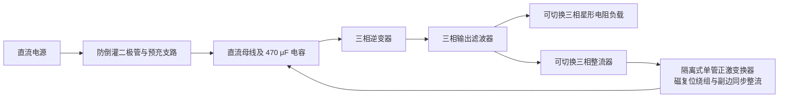

# Energy-Feedback-Based-3Phase-Converter
# 三相变流器能量回馈测试装置

基于 MATLAB2025b 的三相变流器仿真项目，支持电阻负载测试和能量回馈测试。模型通过三相逆变器产生交流电压，并在回馈模式下将交流输出经整流器和隔离式单管正激变换器送回同一直流母线，使外部直流电源主要补充系统损耗。


## 系统结构



- 逆变器采用三相 PWM，基波线电压有效值通过 Type II 补偿器闭环调节。
- 谐波谐振补偿器随设定的基频更新系数。
- 回馈级采用单管正激拓扑，包含磁复位绕组与副边同步整流，以交流电流 RMS 反馈调节回馈负载。
- 母线包含 470 μF 电容、100 Ω 预充电阻及旁路开关，并通过二极管阻止能量倒灌至直流电源。
- 电阻负载与整流回馈支路互斥使能，无需手动改线。

> 本项目的“回馈”是回到装置自身的直流母线，不是向交流电网并网送电。

## 运行环境与文件

建模环境为 **MATLAB R2025b**，需要安装：

- MATLAB
- Simulink
- Simscape
- Simscape Electrical

建议仓库仅保留以下交付文件：

```text
.
├── README.md
└── FinalSolution_AdjustableVF.slx
```

模型工作区变量、初始化逻辑和控制参数已保存在 `.slx` 中。无需上传历史备份、仿真结果 `.mat`、`.slxc` 缓存或 `slprj` 文件夹。其他 MATLAB 版本的兼容性需自行检查。

## 快速开始

1. 下载仓库，将 `FinalSolution_AdjustableVF.slx` 放在本地可写目录中。
2. 使用 MATLAB R2025b 打开模型。
3. 在 Simulink 中打开 **建模 → 模型资源管理器（Model Explorer）**。
4. 在左侧选中该模型下的 **模型工作区（Model Workspace）**。
5. 按下表设置四个用户参数。首次使用可选择 **模式 0、32 V、50 Hz、2 A**。
6. 将仿真停止时间设为 **0.8 s**，点击运行。低频或工作点变化较大时，可延长仿真，待启动过程结束后再读取结果。
7. 修改参数后保存模型，以保留设置。

**请修改模型工作区中的变量，而不是 MATLAB 基础工作区中的同名变量。** 参数和模式应在仿真停止时修改；当前版本按每次仿真一个固定工作点设计，不支持运行中连续调频或带电切换测试模式。

## 用户参数

| 模型工作区变量 | 含义 | 可设置范围 | 示例 |
|---|---|---|---|
| `Test_Mode` | 测试模式 | `0`：电阻负载；`1`：整流回馈 | `0` |
| `CL_Vref` | 输出基波线电压 RMS，单位 V | 大于 0，且不超过 32 | `32` |
| `SPWM_f1` | 输出交流基频，单位 Hz | 20～100 | `50` |
| `Return_Iref` | 电流 RMS 设定，单位 A | 0～2 | `2` |

以上范围是参数输入范围，不代表全部组合均已验证。若需要按 1 Hz 步进调频，在 `SPWM_f1` 中填写相应整数即可。

### 电流设定在两种模式下的含义

- **电阻负载模式：** 根据电压和电流设定值自动计算每相电阻，电阻负载电流取决于实际输出电压；该模式不是独立的电流闭环。
- **整流回馈模式：** `Return_Iref` 是整流器输入侧线电流的总 RMS 闭环给定，包含谐波，不等同于基波电流 RMS。
- **电流设为 0：** 电阻支路和正激有源驱动关闭；输出滤波电容仍可能有交流电流。

电阻负载模式的每相电阻按下式计算：

$$
R_{\mathrm{phase}}=\frac{V_{LL,\mathrm{rms}}}{\sqrt{3}\,I_{\mathrm{load,rms}}}
$$

例如 32 V、2 A 对应每相约 **9.238 Ω**。

### 自动更新的参数

每次仿真初始化时，模型会根据用户设置自动更新：

- 基波电压测量的周期窗口和抗混叠幅值修正；
- 交流电流 RMS 测量窗口；
- 各次谐波谐振补偿系数；
- 调制比前馈、启动等待时间与电流参考斜坡；
- 电阻负载模式的每相电阻。

通常只需修改上述四个用户参数。`CL_N`、`VF_CurrentN`、`VF_LoadR`、`PR_a*`、`PR_b*` 等是派生参数，不建议直接修改。`VF_InitializeCode` 是嵌入模型的初始化代码，由模型 `InitFcn` 调用，应保留。

## 两种测试模式

| 支路或功能 | 模式 0：电阻负载 | 模式 1：整流回馈 |
|---|---|---|
| 三相电阻支路 | 接通 | 断开 |
| 整流器入口开关 | 断开 | 接通 |
| 正激及副边同步整流驱动 | 关闭 | 按启动顺序放行 |
| 直流母线预充 | 启用 | 启用 |
| 基波线电压闭环 | 启用 | 启用 |

三相电阻星点互连，**不与直流负极直接短接**。星点通过 **1 GΩ 弱参考电阻**定位，以避免数值悬浮；该电阻不能用导线替代。是否使能整流器，都不需要把负载星点接回直流负极。

主图中的 `Test_Mode_0_R_1_Return` 常量块引用 `Test_Mode`。建议保留变量名，通过模型工作区统一修改，避免分散修改各支路使能。

## 启动顺序

1. 初始母线电容从零电压启动，逆变器和回馈驱动保持关闭。
2. 直流电源通过 **100 Ω** 电阻预充母线。
3. 实际母线电压达到 **58 V** 后，锁存旁路命令并短接预充电阻。
4. 旁路后延时约 **10 ms**，放行逆变器 PWM；基波电压测量窗口准备好后，电压环开始调节。
5. 回馈模式下，逆变启动后至少等待 **80 ms**，且不少于两个基波周期，再放行正激驱动；电流参考按设定斜坡上升。

因此，仿真开始时交流输出为零属于预充和启动过程。应在启动结束、波形稳定后评价输出指标。

## 信号与结果读取

| 信号或记录变量 | 含义 |
|---|---|
| `cl_vrms` | 电压环使用的基波线电压 RMS 估计 |
| `line_vab` | A、B 相之间的瞬时线电压 |
| `spwm_vabc` | 去除共模后的三相电压信号 |
| `IA_Line_Current` | A 相滤波电感后、滤波电容分支前的电流 |
| `PhaseCurrentA` | A 相整流器入口电流 |
| `rectifier_current_rms` | 回馈电流环的交流电流 RMS 反馈 |
| `I_DcSource_raw` | 电源原始瞬时电流，正方向为电源向母线供电 |
| `actual_dc_bus` | 防倒灌二极管之后的实际直流母线电压 |
| `rect_voltage` | 整流侧电容电压 |
| `acf_output_current` | 正激输出的回馈电流，变量名沿用早期版本 |

`IA_Line_Current` 包含滤波电容支路电流，因此不完全等于电阻负载电流或整流器输入电流。模式 0 下，`PhaseCurrentA` 应接近零，此时不能用它表示电阻负载电流。

**32 V 指基波线电压有效值，不是峰值或相电压。** 对于平衡正弦三相电压，其相电压 RMS 约为 18.48 V，线电压峰值约为 45.25 V。

电源电流可能呈脉冲状：逆变器瞬时取电、正激回馈和母线电容充放电共同决定其波形，防倒灌二极管也会间歇导通。评价外部供能时，应在稳定后的完整基波周期内计算平均功率，不能仅看瞬时峰值。

## 使用边界

- 低交流电压会降低整流电压。当前正激变比约为 **1:4**，最大占空比为 **0.45**，不能保证任意低电压下都能维持回馈及 2 A 电流。
- 二极管限制电流返回直流电源，但不能独立稳压。回馈功率暂时大于逆变器取电功率时，母线电压会升高。
- 调频后会自动更新测量与谐振参数，但这不等于全频段稳定裕度已得到证明。改变工作点后仍应检查电压、电流、母线波动和控制器限幅。
- 本仓库以模型功能交付为主。额定点及全工况的 THD、稳态精度、能量回馈效率与稳定裕度，应以对应工况的完整仿真结果为依据。

## 常见问题

**修改基础工作区变量后，为什么模型没有变化？**  
本模型使用模型工作区参数。请在模型资源管理器中选择该模型的 Model Workspace 后修改。

**为什么电阻负载电流出现很大的直流分量？**  
先检查星点是否被直接接到直流负极，以及 1 GΩ 弱参考电阻是否被短接。共模消除后的显示电压可能看起来正常，因此也应检查电流平均值。

**为什么线电压达不到给定值？**  
检查实际母线电压、负载连接、频率设置，以及 `cl_modulation` 是否持续达到上限。控制器已限幅时，继续增大给定值不能解决供电或连接问题。

**为什么直接点击运行后，没有生成结果文件？**  
模型主要将结果记录到工作区和示波器，不会自动生成 `.mat` 文件或图片。需要保留结果时，请在仿真结束后手动保存或导出。
